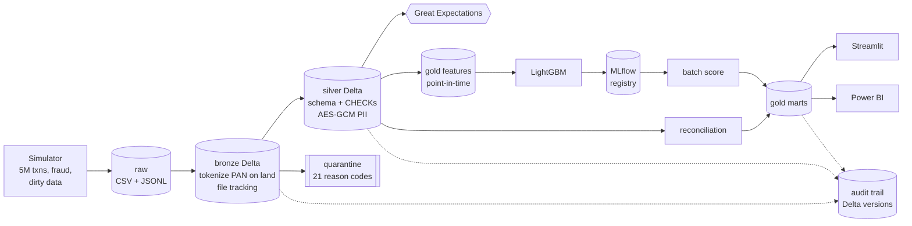

# Financial Transaction ETL & Fraud Detection

**A cloud-portable lakehouse that turns 5M+ messy banking transactions into validated Delta
tables, a tracked fraud model, ledger-vs-settlement reconciliation, and BI dashboards, with
RBAC, encryption, and a full audit trail. Runs at $0 on a laptop or on Databricks Free Edition.**

[](https://github.com/Gnanasudharsan/financial-txn-etl-fraud-detection/actions/workflows/ci.yml)


**Case study site: [ledgerline-seven-self.vercel.app](https://ledgerline-seven-self.vercel.app)** covers the
pipeline, the design decisions, and every measured result, with interactive charts. It's a static site in
[`site/`](site/), and its numbers come from `scripts/build_site_data.py` (`make site-data`, then `make site` to preview). Pushes to `main` that touch `site/` redeploy it automatically.

## Measured results

From one end-to-end `make pipeline ROWS=5000000` run on a 10-core / 16 GB laptop (details and
interpretation in [docs/RESULTS.md](docs/RESULTS.md)). This table is generated from the JSON the
jobs write. Nothing in it is typed by hand.

<!-- BEGIN:readme-results -->
| Metric | Measured |
|---|---|
| Transactions generated (clean / raw incl. injected defects) | 4,996,406 / 5,035,743 |
| Silver rows published / quarantined | 4,914,725 / 121,018 (2.40%) |
| End-to-end pipeline runtime (laptop, `local[*]`) | 25.1 min |
| Fraud model PR-AUC / ROC-AUC (held-out June) | 0.9974 / 0.999959 |
| Recall / precision at validation-tuned threshold (June) | 95.17% / 99.28% |
| Reconciliation: records classified / breaks found | 4,922,108 / 46,743 |
| Recon accuracy vs injected ground truth | 99.99996% (2 of 4,914,701 misclassified) |
| Recon match + publish + break report runtime | 67.4 s |
<!-- END:readme-results -->

> The data is simulated. Simulated fraud is cleaner than real fraud, so read the model metrics as
> proof that the pipeline and evaluation are sound, not as a forecast of production performance.

## Architecture



Storage is accessed through one abstraction (`fintxn.storage.Lake`), so the same code runs on
**SeaweedFS (S3 API) locally, AWS S3, Cloudflare R2, or Databricks Unity Catalog**. Only the
config profile changes. See [docs/ARCHITECTURE.md](docs/ARCHITECTURE.md).

## Features

- **Realistic simulator.** Seeded and chunked, so it fits in laptop memory: 50k customers,
  100k Luhn-valid cards, 20k merchants, six months of data. Five fraud patterns (card testing,
  account takeover, velocity bursts, night-time high amounts, high-risk MCCs) with legitimate
  confounders (travel, VPN geo-jumps, tiny purchases). About 2.4% injected defects: nulls,
  exact and near duplicates, malformed amounts, bad and future timestamps, invalid currencies,
  corrupt lines, schema drift. Also a ledger and settlement feed with deliberate breaks, plus
  ground truth for scoring.
- **Bronze.** Incremental and idempotent: processed-file log plus Delta `txnAppId`/`txnVersion`.
  `PERMISSIVE` parsing keeps `_corrupt_record` and `_rescued_data`. Card numbers become an HMAC
  token at landing, computed in native Spark.
- **Silver.** Explicit `StructType`s; UTC normalization of four timestamp formats; currency and
  text standardization; window-based exact and near dedup; 21 reason codes routed to a
  quarantine table; Delta CHECK constraints; a 23-expectation GX suite; AES-256-GCM
  column encryption.
- **Gold.** 28 leakage-safe features (velocity windows, z-scores, geo speed, new device or
  merchant, train-window MCC risk, lagged merchant fraud rate) and six-plus marts, compacted
  with `OPTIMIZE`/`ZORDER`.
- **ML.** Time-based split, `scale_pos_weight`, threshold tuned on validation for ≥ 95% recall
  and evaluated once on test. MLflow logs params, metrics, plots, and Delta data versions; the
  model is registered with a `champion` alias.
- **Reconciliation.** Two-pass matching (reference key, then auth code + merchant),
  amount ± $0.05 and date ± 2-day tolerance, and seven categories. A runtime benchmark and an
  accuracy check against injected truth.
- **Security.** One RBAC model enforced three times: SeaweedFS identities, AWS IAM roles, and
  Unity Catalog grants. SSE at rest, TLS-ready configs, a role-gated and audited PII decrypt,
  and a Databricks dynamic view that decrypts inside SQL.
- **Auditability.** Every job writes `run_id`, `git_sha`, rows in/out/quarantined, DQ pass
  rate, and the exact Delta versions it wrote. `fintxn time-travel <run_id>` reproduces any
  run.
- **Orchestration.** Databricks Asset Bundle (`databricks.yml`) plus an equivalent Airflow DAG.
  A parity test keeps the two in sync.
- **BI.** A seven-page Streamlit app backed by committed, aggregated, PII-free Parquet. Power BI
  star-schema extracts plus DAX measures.

## Quickstart

Prerequisites: macOS or Linux, Docker, Java 17, [uv](https://docs.astral.sh/uv/), Python 3.11
(`uv python install 3.11`).

```bash
make setup && make up && make pipeline
```

- `make setup` installs pinned dependencies and git hooks, and writes `.env` with random keys.
- `make up` starts SeaweedFS (S3 API on :8333) and creates encrypted buckets.
- `make pipeline` runs generate → bronze → silver → gold → train → score → recon → export.
  Use `ROWS=200000` for a quick run.

Individual stages: `make generate bronze silver gold train score recon export`.
Then `make dashboard` (Streamlit), `make mlflow-ui` (MLflow at :5000), `make audit` (audit
trail), and `make test` / `make lint`.

## Dashboard

```bash
make dashboard
```

| Page | Shows |
|---|---|
| Fraud KPIs | daily volume, fraud rate (bps), fraud amount |
| Alerts & precision | true vs false positives, daily precision and recall, capture by fraud pattern |
| Merchant risk | leaderboard with filters |
| Reconciliation | breaks by type and business date |
| Data quality | pass rate, quarantine by reason |
| Pipeline audit | every run, with Delta versions and the time-travel command |

<!-- Screenshots: add docs/img/dashboard-*.png after deploying -->
_Screenshot placeholders: `docs/img/dashboard-overview.png`, `docs/img/dashboard-alerts.png`._

**Deploy free on Streamlit Community Cloud:** share.streamlit.io → *New app* → this repo,
branch `main`, main file `dashboards/app.py`. Dependencies come from
`dashboards/requirements.txt`, and data from the committed `dashboards/data/*.parquet`. No
secrets are needed.

## Deploy on Databricks Free Edition

```bash
databricks bundle validate -t dev && databricks bundle deploy -t dev && databricks bundle run fintxn_pipeline -t dev
```

Full steps (CLI install, OAuth login, secret scope, Volume upload, Unity Catalog grants):
[docs/DEPLOY_DATABRICKS.md](docs/DEPLOY_DATABRICKS.md).

## Design decisions

The full log is in [docs/DECISIONS.md](docs/DECISIONS.md). Highlights:

- **Bucket per medallion layer.** RBAC maps one-to-one onto buckets, IAM ARNs, and UC schemas.
- **Tokenize at landing.** A PAN never reaches a Delta file, so it never reaches time-travel
  history either.
- **Row rules quarantine; GX certifies.** Reason codes need row-level logic. GX is the contract
  on what was published.
- **Point-in-time features by construction.** Windows end at −1 s; MCC risk is fitted on the
  training window only; merchant fraud uses only reports dated before the transaction.
- **Honest evaluation.** The first simulation was too easy (PR-AUC 0.9994), so confounders
  were added and the full pipeline was rerun (D-011).
- **SeaweedFS instead of MinIO.** MinIO's community images and binaries are no longer
  distributed (D-001). The code only speaks S3.

## $0 cost

| Component | How it stays free |
|---|---|
| Compute | Spark `local[*]` on your laptop, or Databricks Free Edition serverless |
| Object storage | SeaweedFS in Docker (Apache-2.0); optional AWS S3 free tier (5 GB) or Cloudflare R2 (10 GB) |
| ML tracking | MLflow with SQLite locally; workspace MLflow on Databricks |
| Orchestration | Make / Airflow in Docker / Databricks Jobs |
| BI | Streamlit Community Cloud; Power BI Service free tier |
| CI | GitHub Actions on a public repo |
| IaC | Terraform `validate` only; AWS Budget alarm at $5 if you choose to `apply` (the KMS key is ~$1/month, or use `use_kms=false` for SSE-S3) |

## Project structure

```
├── src/fintxn/            # package: cli, config, spark, storage, audit, pipeline
│   ├── generate/          # simulator (dims, transactions, fraud, dirty data, ledger/settlement)
│   ├── bronze/ silver/ gold/ quality/ ml/ recon/ security/ export/
├── configs/               # base + local / ci / aws / r2 / databricks profiles
├── infra/terraform/       # S3, KMS, IAM roles, bucket policies, budget
├── infra/seaweedfs/       # local S3 identities (RBAC)
├── databricks.yml         # Asset Bundle; databricks/resources (job), databricks/sql (grants, views)
├── dags/                  # Airflow DAG (mirrors the Databricks job)
├── dashboards/            # Streamlit app + committed aggregated extracts
├── notebooks/             # exploration only (not source of truth)
├── scripts/               # bootstrap .env, render results
├── tests/unit, tests/integration
└── docs/                  # ARCHITECTURE, DATA_DICTIONARY, DECISIONS, RESULTS, SECURITY, DEPLOY_DATABRICKS, POWERBI, PROGRESS
```

## Roadmap

- Streaming ingestion (Auto Loader / Structured Streaming) on the same bronze contract
- Champion/challenger evaluation and drift monitoring on score distributions
- Graph features (shared devices and IPs across cards)
- Delta Live Tables expectations as an alternative to GX on Databricks
- Row-level security and column masks via UC functions instead of views

## License

MIT, see [LICENSE](LICENSE).
