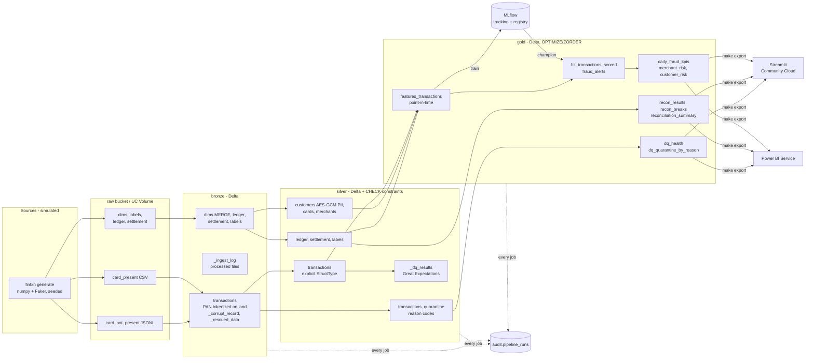

# Architecture

## Overview



## Runtime targets

| Concern | Laptop (default) | AWS | Cloudflare R2 | Databricks Free Edition |
|---|---|---|---|---|
| Object storage | SeaweedFS S3 API (Docker) | S3 (Terraform) | R2 | UC Volume (raw) + UC managed tables |
| Compute | Spark `local[*]` | Spark anywhere with s3a | Spark with s3a | Serverless |
| Config profile | `local` | `aws` | `r2` | `databricks` |
| Orchestration | Makefile / Airflow (compose profile) | – | – | Databricks Jobs via Asset Bundle |
| MLflow | SQLite + local artifacts | – | – | Workspace MLflow + UC registry |
| Secrets | `.env` | env / IAM role | env | secret scope |

Only `configs/*.yaml` differs between targets. `fintxn.storage.Lake` addresses tables as
`(layer, name)` and resolves them to `s3a://fintxn-<layer>/<name>`, a local path, or
`<catalog>.fintxn_<layer>.<name>`. That is what makes the multi-cloud claim honest: the
transforms never see a URI.

## Code layout

```
src/fintxn/
  cli.py           Typer CLI: one command per stage (the only entry point used by Make, Airflow, Databricks)
  config.py        layered YAML + ${ENV} interpolation -> pydantic Settings
  spark.py         SparkSession factory (Delta, s3a, AQE, UTC); reuses the session on Databricks
  storage.py       ObjectStore (S3 / local / Volume) + Lake (Delta IO by layer/name)
  audit.py         job_run() context manager -> audit.pipeline_runs
  pipeline.py      end-to-end runner with timing report
  generate/        simulator: dimensions, transactions + fraud episodes, dirty data, ledger/settlement
  bronze/          raw schemas, incremental idempotent ingestion
  silver/          pure transforms (standardize/validate/dedup) + job (MERGE, constraints, GX)
  quality/         Great Expectations suite
  gold/            point-in-time features, marts, OPTIMIZE
  ml/              LightGBM training (MLflow) and batch scoring
  recon/           reconciliation engine + job with ground-truth accuracy
  security/        HMAC tokenization, AES-GCM encryption, role gate
  export/          Streamlit + Power BI extracts
```

## Key flows

**Incremental ingestion.** Bronze lists raw objects, skips `(key, size)` pairs already in
`_ingest_log`, and appends new files with Delta `txnAppId/txnVersion = batch_id`. Silver
processes bronze rows with `_batch_id > watermark` and MERGEs into silver on `transaction_id`
(insert-only), so replays across batches never duplicate. The generator's
`--chunk-from/--chunk-to --append` flags demo this.

**Point-in-time features.** All windows end one second (or one row) before the current
transaction. MCC risk is fitted on the training window only. Merchant fraud rates count only
reports dated before the transaction's day. See `gold/features.py`.

**Model lifecycle.** `train` logs params, metrics, plots, and Delta versions to MLflow, registers
a new version and moves the `champion` alias. `score` always loads `models:/<name>@champion` and
applies the threshold stored as a model-version tag, so promotion is a registry operation
rather than a code change.
