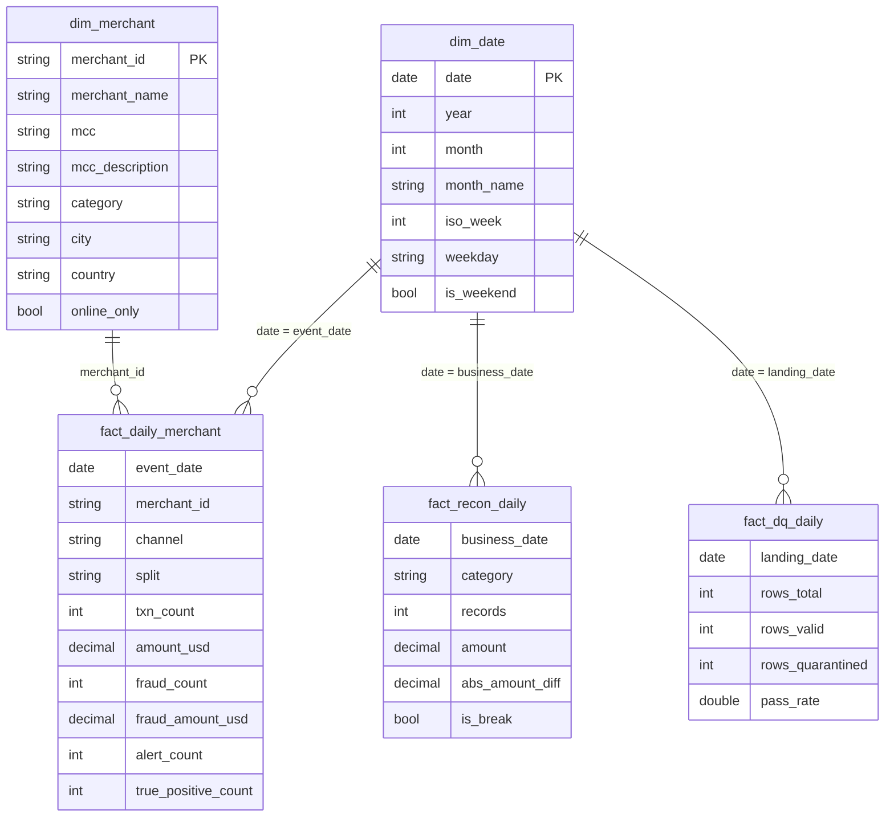

# Power BI (Service, web)

Power BI Desktop is Windows-only, so this model is built entirely in **Power BI Service**
(app.powerbi.com) using web data modeling. `make export` writes the extracts to
`data/exports/powerbi/` as both CSV and Parquet.

## Star schema



Grain: `fact_daily_merchant` is one row per **date × merchant × channel × split**. For the 5M
run that is 2,113,614 rows (12 MB Parquet, 101 MB CSV), a 57% reduction from transaction grain.
Use the Parquet file where your loader supports it. No customer-level data is exported.

## Load into Power BI Service

1. Put `data/exports/powerbi/*.csv` in a OneDrive / SharePoint folder.
2. In a workspace: **New → Semantic model → Get data → Text/CSV** (or **Dataflow Gen1/Gen2 →
   Folder**) and load all five tables.
3. Open the semantic model → **Open data model** (web modeling) and create the relationships:

| From (many) | To (one) | Cardinality | Filter direction |
|---|---|---|---|
| `fact_daily_merchant[event_date]` | `dim_date[date]` | many-to-one | single |
| `fact_daily_merchant[merchant_id]` | `dim_merchant[merchant_id]` | many-to-one | single |
| `fact_recon_daily[business_date]` | `dim_date[date]` | many-to-one | single |
| `fact_dq_daily[landing_date]` | `dim_date[date]` | many-to-one | single |

4. Mark `dim_date` as the date table (column `date`).

## DAX measures

Create these on `fact_daily_merchant` (or a dedicated `_Measures` table):

```dax
Transactions = SUM ( fact_daily_merchant[txn_count] )

Transaction Amount (USD) = SUM ( fact_daily_merchant[amount_usd] )

Fraud Transactions = SUM ( fact_daily_merchant[fraud_count] )

Fraud Amount (USD) = SUM ( fact_daily_merchant[fraud_amount_usd] )

Fraud Rate (bps) = DIVIDE ( [Fraud Transactions], [Transactions] ) * 10000

Alerts = SUM ( fact_daily_merchant[alert_count] )

True Positives = SUM ( fact_daily_merchant[true_positive_count] )

Alert Precision = DIVIDE ( [True Positives], [Alerts] )

Fraud Recall = DIVIDE ( [True Positives], [Fraud Transactions] )

False Positives = [Alerts] - [True Positives]

Fraud Rate 7d Avg (bps) =
VAR _end = MAX ( dim_date[date] )
RETURN
    CALCULATE ( [Fraud Rate (bps)], DATESINPERIOD ( dim_date[date], _end, -7, DAY ) )

Held-out Test Precision =
CALCULATE ( [Alert Precision], fact_daily_merchant[split] = "test" )

Recon Records = SUM ( fact_recon_daily[records] )

Recon Breaks = CALCULATE ( [Recon Records], fact_recon_daily[is_break] = TRUE () )

Recon Match Rate = DIVIDE ( [Recon Records] - [Recon Breaks], [Recon Records] )

DQ Pass Rate = DIVIDE ( SUM ( fact_dq_daily[rows_valid] ), SUM ( fact_dq_daily[rows_total] ) )
```

## Suggested report pages

1. **Fraud overview** – cards: Transactions, Fraud Rate (bps), Fraud Amount; line: Fraud Rate
   7d Avg by `dim_date[date]`; slicer on `split`.
2. **Model alerts** – clustered columns: True Positives vs False Positives by week; cards:
   Alert Precision, Fraud Recall (filter `split = "test"` for the honest held-out view).
3. **Merchant risk** – table of `dim_merchant` with Fraud Transactions, Fraud Rate (bps),
   Alerts; top-N filter on Fraud Transactions.
4. **Operations** – stacked columns: Recon Records by `category` (filter `is_break`); line: DQ
   Pass Rate by date.
